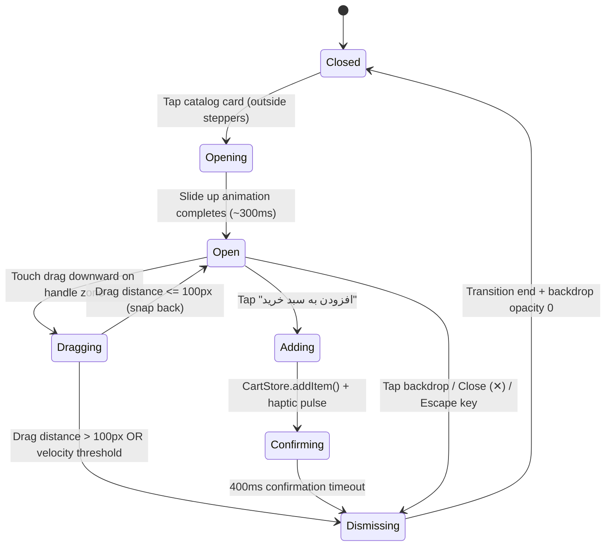

# Data Model: Mobile Landing Page & Menu Detail Unslopping

**Feature Branch**: `001-mobile-menu-detail`  
**Date**: 2026-11-02  
**Status**: Completed  

---

## 1. Entities

### 1.1 ProductCatalogItem

Represents a specialty beverage or bakery item in Soren Café's client-side catalog.

```typescript
interface ProductCatalogItem {
  id: string;              // Unique slug, e.g., 'espresso-double'
  name: string;            // Persian title, e.g., 'اسپرسو دبل'
  category: 'coffee' | 'shakes' | 'cake'; // Menu category
  price: number;           // Unit price in Tomans, e.g., 85000
  image: string;           // Asset path, e.g., 'assets/espresso.jpg'
  desc: string;            // Editorial description
  tag: string;             // Authentic provenance tag (e.g., 'عصاره‌گیری ۹ بار')
  isAvailable: boolean;    // Stock availability flag (defaults to true)
  specs: {
    origin: string;        // Bean terroir / source, e.g., 'اتیوپی یرگاچف ۱۰۰٪ عربیکا'
    brewMethod: string;    // Extraction method, e.g., 'اسپرسو ماشین لا مارزوکو ۹ بار'
    temperature: string;   // Serving temperature, e.g., '۹۳.۵ درجه سانتی‌گراد'
    tastingNotes: string;  // Flavor profile, e.g., 'یاس، مرکبات، عسل وحشی'
  };
}
```

#### Validation & Constraints
- `price` MUST be a positive integer formatted as Persian tabular numerals in the UI.
- `id` MUST match the `data-id` attribute on the corresponding `.featured-card` or `.product-card`.
- When `isAvailable === false`, the product card and detail sheet must signal out-of-stock status, disabling addition to cart while preserving tasting notes.
- On mobile viewports, `.featured-card` MUST display at most 1 primary badge in `.featured-top` (FR-016), deferring all secondary tags to `specs`.
- `name` MUST gracefully clamp at 2 lines on mobile 2-column grids via `-webkit-line-clamp: 2` (FR-013).
- `image` MUST fail gracefully on load error (`onerror`) by loading the fallback emblem canvas without breaking card layout (FR-017).

---

### 1.2 MenuDetailState (Transient UI State)

Manages the lifecycle and touch interactions of the bottom sheet modal.

```typescript
interface MenuDetailState {
  isOpen: boolean;             // Whether sheet is currently presented
  activeProductId: string | null; // ID of the currently inspected item
  dragStartY: number;          // Initial touch clientY on drag handle
  currentTranslateY: number;   // Live drag offset in pixels
  isDismissing: boolean;       // Lock flag during dismiss transition
}
```

#### Lifecycle & State Transitions


---

### 1.3 CartItem (Persisted Store Entity)

Stored in `localStorage` under key `soren_cart_v1` via `SorenCartStore`.

```typescript
interface CartItem {
  id: string;        // Product ID
  name: string;      // Persian name
  price: number;     // Single unit price
  quantity: number;  // Selected count (>= 1)
  updatedAt: number; // Millisecond timestamp
}
```

---

## 2. Data Store Synchronizations

- `SorenCartStore.addItem(id, quantity = 1)` emits custom DOM event `soren:cart-changed`.
- Floating bottom bar badge, bottom nav badge, and in-card steppers subscribe to `soren:cart-changed` to keep all counts synchronized in real time.
- All product metadata is embedded directly in client-side catalog structures (`PRODUCT_CATALOG` in `main.js`), requiring 0ms network latency to populate the bottom sheet.
