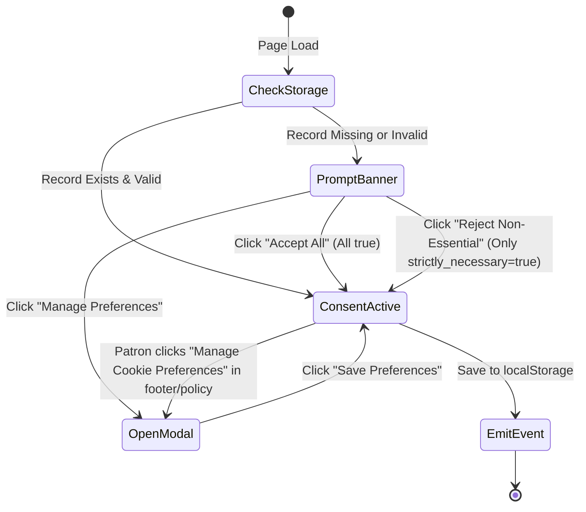

# Data Model: Terms & Conditions, Cookie Policy & Consent State

**Feature Branch**: `feat/terms-and-cookies` (`002-terms-and-cookies`)  
**Date**: 2026-11-09  
**Status**: Completed  

---

## 1. Entities

### 1.1 CookieConsentRecord (Persistent Client State)

Represents user consent choices persisted in browser `localStorage` under key `soren_cookie_consent`.

```typescript
interface CookieConsentRecord {
  version: number;               // Schema version (e.g. 1)
  timestamp: string;             // ISO 8601 UTC string when decision was recorded
  categories: {
    strictly_necessary: true;    // Always true; immutable
    analytics: boolean;          // Bun telemetry, page performance, traffic metrics
    functional: boolean;         // Sound feedback, language toggle, UI preferences
    marketing: boolean;          // Campaign referral vouchers, seasonal banners
  };
}
```

#### Validation & Constraints
- `version` MUST be integer `1`. If future versions introduce changes, migrations must auto-upgrade while preserving prior affirmative consent.
- `strictly_necessary` MUST always be boolean `true`. If tampered with in storage, the parser forces it to `true`.
- If `localStorage` access throws an exception (e.g., SecurityError in strict sandboxes), the runtime gracefully falls back to an in-memory session object.

---

### 1.2 CookieDisclosureItem

Represents a single cookie or client storage key documented in the Cookie Policy disclosure table.

```typescript
type CookieCategory = 'strictly_necessary' | 'analytics' | 'functional' | 'marketing';

interface CookieDisclosureItem {
  id: string;                    // Technical storage key, e.g. 'soren_cart_v1'
  name: string;                  // Human-readable title (Persian & English)
  category: CookieCategory;      // Associated classification
  provider: string;              // Entity setting the cookie, e.g. 'کافه سورن (داخلی)'
  purpose: string;               // Detailed rationale for data storage
  duration: string;              // Retention period, e.g. '۳۰ روز' / 'Session'
  type: 'LocalStorage' | 'Cookie' | 'SessionStorage';
}
```

#### Canonical Inventory for Soren Café:
1. `soren_cart_v1`: Strictly Necessary | LocalStorage | Persists active customer order items | 30 days
2. `soren_table_id`: Strictly Necessary | LocalStorage | Persists scanned table assignment | 24 hours
3. `soren_auth_token`: Strictly Necessary | LocalStorage | Administrative barista session key | 7 days
4. `soren_cookie_consent`: Strictly Necessary | LocalStorage | Recorded privacy preferences | 365 days
5. `soren_sound_feedback`: Functional | LocalStorage | Web Audio tactile clicks toggle | 180 days
6. `soren_intro_seen`: Functional | SessionStorage | Suppresses opening preloader animation | Session
7. `soren_telemetry_id`: Analytics | LocalStorage | Anonymous client instance identifier | 90 days

---

### 1.3 LegalClauseSection

Represents a structured clause in Terms & Conditions or Cookie Policy.

```typescript
interface LegalClauseSection {
  id: string;                    // Anchor slug, e.g. 'clause-refunds'
  number: string;                // Section number, e.g. '۴' or '4.1'
  titleFa: string;               // Persian heading, e.g. 'شرایط بازپرداخت و لغو سفارش'
  titleEn: string;               // English heading, e.g. 'Refund & Cancellation Policy'
  contentFa: string;             // Editorial prose in Persian
  summaryEn: string;             // Concise English mirror summary
  keywords: string[];            // Search indexing terms for quick jump
}
```

---

## 2. State Machine: Cookie Consent Lifecycle


